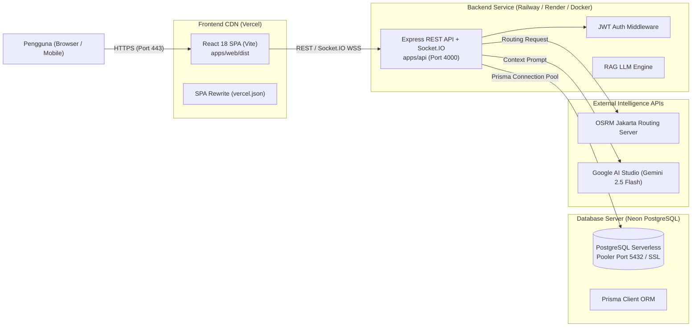

# Panduan Deployment & Setup Server Cloud — KosMatch Jakarta

Dokumen ini menjelaskan arsitektur cloud, konfigurasi basis data produksi, dan langkah deployment bertahap untuk aplikasi **KosMatch Jakarta**.

---

## 1. Arsitektur Cloud Produksi

Aplikasi KosMatch dirancang dengan arsitektur decoupled (*frontend-backend separation*) untuk performa tinggi, skalabilitas, dan efisiensi biaya:



---

## 2. Setup Database Server Produksi (Neon PostgreSQL)

### 2.1 Spesifikasi Server Basis Data
- **Platform:** Neon Serverless PostgreSQL (AWS Region `ap-southeast-1` Singapore).
- **Protokol Keamanan:** Wajib menggunakan SSL (`sslmode=require`).
- **Connection Pooling:** Gunakan endpoint pooler (`-pooler.c-3.ap-southeast-1.aws.neon.tech`) untuk menangani lonjakan koneksi konkurensi tinggi.

### 2.2 Format Connection String Produksi
```bash
DATABASE_URL="postgresql://<username>:<password>@<ep-pooler>.c-3.ap-southeast-1.aws.neon.tech/neondb?sslmode=require&channel_binding=require"
```

### 2.3 Sinkronisasi Skema & Seeding Data
Jalankan langkah berikut untuk menginisialisasi skema dan dataset kos pada basis data produksi:

```bash
# 1. Generate Prisma Client
pnpm db:generate

# 2. Sinkronkan skema tabel ke database produksi
pnpm db:push

# 3. Masukkan 2.308 data kos dan akun demo
pnpm db:seed
```

---

## 3. Setup Deployment Backend API

Backend API mendukung dua metode deployment cloud:

### Opsi A: Deployment via PaaS (Railway / Render)
1. Hubungkan repository GitHub ke **Railway** atau **Render**.
2. **Pengaturan Render (`render.yaml`):**
   - File konfigurasi blueprint telah tersedia di [`render.yaml`](../render.yaml).
   - Build Command: `pnpm install --frozen-lockfile && pnpm db:generate`
   - Start Command: `pnpm --filter @kosmatch/api start`
   - Health Check Path: `/api/health`
3. **Pengaturan Railway (`railway.toml`):**
   - File konfigurasi telah tersedia di [`railway.toml`](../railway.toml).
   - Railway otomatis mendeteksi Dockerfile atau runtime Node.
4. **Environment Variables Wajib (Backend):**
   | Variabel | Nilai Contoh | Keterangan |
   |---|---|---|
   | `NODE_ENV` | `production` | Mode produksi Node.js |
   | `PORT` | `4000` | Port aplikasi |
   | `JWT_SECRET` | *(string acak ≥ 32 karakter)* | Kunci penandatanganan token JWT |
   | `CORS_ORIGIN` | `https://kosmatch-web.vercel.app` | Domain frontend yang diizinkan |
   | `DATA_STORE` | `postgres` | Mengaktifkan PostgreSQL Prisma |
   | `DATABASE_URL` | `postgresql://...` | Connection string Neon pooler |
   | `USE_MOCK_AI` | `false` | Mengaktifkan LLM Gemini nyata |
   | `GEMINI_API_KEY` | `AIzaSy...` | API key dari Google AI Studio |
   | `LLM_MODEL` | `gemini-2.5-flash` | Model Gemini yang digunakan |
   | `COMMUTE_PROVIDER` | `osrm` | Engine rute jalan raya OSRM |
   | `OSRM_BASE_URL` | `https://router.project-osrm.org` | Server routing OpenStreetMap |

### Opsi B: Deployment via Docker Container
Tersedia `Dockerfile` multi-stage di root dan [`apps/api/Dockerfile`](../apps/api/Dockerfile):

```bash
# Build Docker Image
docker build -t kosmatch-api -f Dockerfile .

# Menjalankan Container
docker run -d -p 4000:4000 --env-file .env.production --name kosmatch-api-prod kosmatch-api
```

Atau menggunakan Docker Compose:
```bash
docker compose up -d
```

---

## 4. Setup Deployment Frontend Web (Vercel)

Frontend React Vite di-hosting pada jaringan Edge CDN Vercel:

1. Buka dashboard [Vercel](https://vercel.com) dan impor repository `KosMatch_Group4`.
2. **Pengaturan Proyek di Vercel:**
   - **Root Directory:** Pilih direktori `apps/web`.
   - **Framework Preset:** `Vite`.
   - **Build Command:** `pnpm build` atau `npm run build`.
   - **Output Directory:** `dist`.
3. **Environment Variables (Frontend):**
   | Variabel | Nilai | Keterangan |
   |---|---|---|
   | `VITE_API_BASE_URL` | `https://kosmatch-api.up.railway.app` | URL domain backend API produksi |
4. **Konfigurasi SPA Routing ([`apps/web/vercel.json`](../apps/web/vercel.json)):**
   Telah dikonfigurasi aturan rewrite agar rute halaman (*deep link* seperti `/kos/:id`, `/tersimpan`, `/chat`) tidak mengalami error 404 saat pengguna melakukan refresh halaman.

---

## 5. Verifikasi Deployment & Health Check

Setelah backend dan frontend ter-deploy ke cloud, lakukan pengujian berikut:

1. **Uji Health Check API:**
   ```bash
   curl -i https://<domain-backend>/api/health
   # Respon yang diharapkan: HTTP 200 OK {"ok":true,"data":{"status":"ok",...}}
   ```
2. **Uji Koneksi WebSocket (Socket.IO):**
   Pastikan koneksi WebSocket berjalan melalui protokol `wss://<domain-backend>/socket.io/`.
3. **Uji Autentikasi & CORS:**
   Masuk melalui antarmuka web dan verifikasi bahwa header `Access-Control-Allow-Origin` merespons dengan benar sesuai domain frontend.
4. **Uji Rekomendasi AI & Komuter:**
   Kirim pertanyaan di chatbot overlay untuk memastikan integrasi Gemini dan OSRM merespons di lingkungan cloud.

---

## 6. Checklist Keamanan Produksi

- [x] Password hash tidak pernah terekspos di respon API.
- [x] JWT Secret di-generate secara acak dan tidak menggunakan default lokal.
- [x] Database PostgreSQL dilindungi enkripsi SSL (`sslmode=require`).
- [x] Endpoint frontend dilindungi aturan SPA rewrites (`vercel.json`).
- [x] Dockerfile menggunakan user non-root dan menyertakan healthcheck otomatis.
- [x] Skrip CI/CD continuous deployment disiapkan di `.github/workflows/deploy.yml`.
