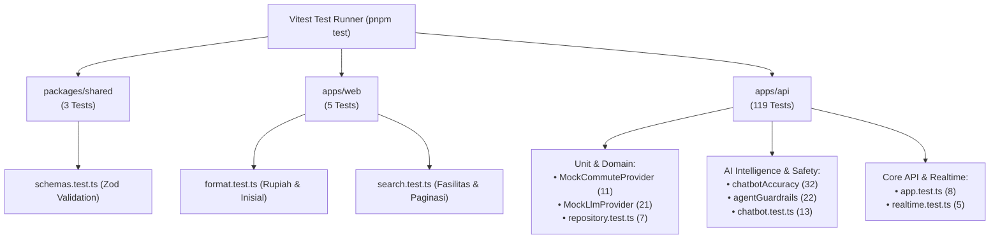

# Laporan Pengujian Pengembang (Developer Automated Testing Report) — Vitest

Dokumen ini memuat dokumentasi teknis pengujian otomatis (*automated testing*) dari sisi pengembang (*developer*) pada proyek **KosMatch Jakarta**. Pengujian diimplementasikan menggunakan **Vitest**, **Supertest**, dan **Socket.IO Client** di seluruh workspace monorepo (`packages/shared`, `apps/web`, dan `apps/api`).

---

## 1. Ringkasan Eksekutif & Metrik Pengujian

Seluruh pengujian unit (*unit test*) dan pengujian integrasi (*integration test*) dijalankan melalui runner Vitest dengan hasil **100% HIJAU (PASSED)**.

```text
================================================================================
Test Execution Summary (Vitest v2.1.9)
================================================================================
✓ packages/shared  : 1 test file  |   3 tests passed
✓ apps/web         : 2 test files |   5 tests passed
✓ apps/api         : 8 test files | 119 tests passed
--------------------------------------------------------------------------------
TOTAL              : 11 test files| 127 tests passed (0 failed, 0 skipped)
Durasi Eksekusi    : ~4.2 detik (Paralel Monorepo)
Status Kualitas    : SEHAT (Production-Ready)
================================================================================
```

### Karakteristik Desain Pengujian Pengembang:
1. **Deterministik & Cepat:** Semua dependensi eksternal (LLM dan Google Maps) berada di balik antarmuka (*interface*) dan menggunakan implementasi mock deterministik saat pengujian, sehingga pengujian berjalan cepat tanpa latensi jaringan.
2. **Isolasi Data (Hermetic Testing):** Pengujian API menggunakan `createTestContext()` yang menginisialisasi server Express dan WebSocket pada *ephemeral port* (port acak sistem) dengan memori RAM yang bersih (*isolated memory repository*), mencegah terjadinya *flaky tests* akibat *state collision*.
3. **Cakupan Berlapis (*Layered Coverage*):** Menguji dari level skema Zod paling dasar, helper fungsi frontend, aturan domain backend, keamanan guardrails, hingga WebSocket real-time dua arah.

---

## 2. Cara Menjalankan Pengujian di Terminal

Pengembang dapat menjalankan seluruh rangkaian uji atau menargetkan package tertentu menggunakan perintah berikut:

```bash
# 1. Menjalankan seluruh test suite di seluruh monorepo
pnpm test

# 2. Menjalankan test pada package tertentu
pnpm --filter @kosmatch/shared test   # Pengujian skema validasi Zod
pnpm --filter @kosmatch/web test      # Pengujian komponen & helper frontend
pnpm --filter @kosmatch/api test      # Pengujian API, Database, Guardrail, & Realtime

# 3. Menjalankan test dalam mode watch (interaktif saat ngoding)
pnpm --filter @kosmatch/api exec vitest

# 4. Menjalankan satu file test spesifik
pnpm --filter @kosmatch/api exec vitest run src/chatbotAccuracy.test.ts
```

---

## 3. Rincian Suite Pengujian per Paket



---

### A. Paket `packages/shared` (3 Pengujian)

Menguji skema validasi Zod yang bertindak sebagai *Single Source of Truth* antara Frontend dan Backend.

* **Berkas:** `packages/shared/src/schemas.test.ts`
* **Jumlah Pengujian:** 3 Tests
* **Fokus Pengujian:**
  1. `coerces numeric strings in KosFormSchema`: Memverifikasi bahwa data numerik bertipe string dari form input (misal `"2000000"`, `"-6.2"`) berhasil dikonversi secara aman (*type coercion*) menjadi `number` integer dan float.
  2. `rejects empty and oversized messages`: Memastikan skema pesan `SendMessageInputSchema` menolak pesan kosong (hanya spasi) dan pesan melebihi batas 1.000 karakter.
  3. `rejects unknown modes in ChatParamsSchema`: Memastikan enum moda transportasi hanya menerima moda resmi (`ojek`, `transit`, `jalan`) dan menolak input asing (misal `"helikopter"`).

---

### B. Paket `apps/web` (5 Pengujian)

Menguji helper komputasi, fungsi format, dan algoritma pemfilteran yang digunakan oleh antarmuka React.

#### 1. Berkas: `apps/web/src/lib/format.test.ts` (2 Tests)
* `formats rupiah with dots`: Memastikan angka integer diformat ke standar mata uang Indonesia dengan pemisah titik (contoh: `1800000` $\rightarrow$ `"Rp 1.800.000"`).
* `builds initials`: Memastikan pembuatan inisial avatar bekerja akurat dari nama pengguna majemuk (contoh: `"Bu Sari (Pemilik)"` $\rightarrow$ `"BS"`, `"Demo Penyewa"` $\rightarrow$ `"DP"`).

#### 2. Berkas: `apps/web/src/lib/search.test.ts` (3 Tests)
* `has valid facility filter options`: Memastikan daftar opsi filter fasilitas memuat entri kunci (`ac`, `km_dalam`, `wifi`, dll).
* `matches facilities accurately`: Menguji fungsi pencocokan fasilitas (`kosHasFilteredFacility`) baik dari array fasilitas maupun teks deskripsi kos.
* `computes pagination page numbers correctly`: Menguji algoritma kalkulasi halaman paginasi (`getPaginationPages`) termasuk penempatan ellipsis (`...`) pada rentang halaman yang panjang.

---

### C. Paket `apps/api` (119 Pengujian)

Merupakan suite pengujian terbesar yang mencakup logika bisnis backend, kecerdasan buatan, keamanan guardrail, persistensi basis data, dan komunikasi real-time.

---

#### 1. Berkas: `src/providers/commute/MockCommuteProvider.test.ts` (11 Tests)
Menguji formula estimasi komuter deterministik sesuai aturan PRD:
* **Kalkulasi Jarak:** Menguji perhitungan jarak *great-circle* (Haversine) dikalikan faktor jalan darat 1.3.
* **Moda Ojek Online:** Kecepatan rata-rata 22 km/jam, durasi dibulatkan ke atas, tarif Rp 3.000/km dengan tarif minimum Rp 8.000 dan pembulatan ke kelipatan Rp 500.
* **Moda Transit Umum:** Kecepatan 28 km/jam + 10 menit waktu tunggu stasiun/halte, batas tarif maksimal Rp 10.000.
* **Transit Transfer Logic:** Perpindahan armada ditentukan jarak (<5 km: 0 transfer, <15 km: 1 transfer, $\ge$15 km: 2 transfer).
* **Kepatuhan Respons:** Memastikan setiap hasil estimasi komuter wajib memuat tag metadata `isEstimate: true` dan `source: "mock"`.

---

#### 2. Berkas: `src/data/repository.test.ts` (7 Tests)
Menguji abstraksi penyimpanan data berbasis *Repository Pattern*:
* **CRUD Kos & Filtering:** Menguji operasi Create, Read, Update, Delete properti kos serta pemfilteran berdasarkan harga maksimal, gender tipe kos, kata kunci pencarian, dan ID pemilik kos.
* **Bookmark Idempotency:** Memastikan penambahan bookmark yang sama berkali-kali bersifat idempoten (mengembalikan data yang ada tanpa duplikasi di basis data).
* **Isolasi Pengguna:** Menghapus bookmark pada Pengguna A tidak mempengaruhi bookmark Pengguna B.
* **Pengurutan Percakapan Chat:** Mengambil riwayat percakapan antara dua pengguna secara kronologis urut waktu, serta menyusun daftar kontak percakapan terakhir (*latest conversations*).
* **Pencarian Email Case-Insensitive:** Memastikan login pengguna bekerja terlepas dari variasi huruf besar/kecil email (`A@x.test` sama dengan `a@X.test`).
* **Seeding Verification:** Memvalidasi bahwa proses seeding berhasil mengisi 4 akun demo, 11 destinasi komuter, 12 kos awal, 3 chat, dan 2 bookmark.
* **Data Store Selection & Prisma Fallback:** Memastikan factory `createRepository` melempar pesan *"Provider belum diimplementasikan"* untuk tipe store yang tidak didukung (misal `mysql`), dan sukses menginisialisasi `PrismaRepository` untuk store `postgres`.

---

#### 3. Berkas: `src/providers/llm/MockLlmProvider.test.ts` (21 Tests)
Menguji parser heuristik percakapan Bahasa Indonesia pada modul AI:
* **Ekstraksi Destinasi Populer:** Pengenalan nama kampus dan kawasan bisnis melalui sinonim/alias (contoh: *"UI"*, *"Depok"*, *"Kemanggisan"*, *"Trisakti"*, *"Grogol"*, *"SCBD"*, *"Thamrin"*, *"Kuningan"*).
* **Ekstraksi Anggaran Sewa (Budget):** Menganalisis berbagai format penulisan angka masyarakat Indonesia (contoh: `"2 juta"`, `"2jt"`, `"1.5 jt"`, `"dibawah 3000000"`).
* **Ekstraksi Fasilitas & Gender:** Mendeteksi kebutuhan fasilitas (AC, WiFi, kamar mandi dalam) dan tipe kos (putri, putra, campur).
* **Komposisi Respons:** Menyusun kalimat jawaban yang natural, informatif, dan relevan berdasarkan jumlah hasil pencarian yang ditemukan di basis data.

---

#### 4. Berkas: `src/chatbotAccuracy.test.ts` (32 Tests)
Merupakan *Quality Assurance Accuracy Benchmark* komprehensif untuk menguji akurasi ekstraksi parameter chatbot terhadap berbagai variasi kalimat pengguna nyata:
* **11 Destinasi & Alias (11 tests):** Menguji pengenalan seluruh 11 titik destinasi (Universitas Indonesia, Binus, Trisakti, UNJ, Atma Jaya, SCBD, Sudirman/Thamrin, Kuningan, Stasiun Sudirman, Stasiun Tebet, Stasiun Palmerah).
* **Variasi Pola Budget (6 tests):** Menguji toleransi penulisan anggaran (kata sandang *"budget"*, *"maksimal"*, *"di bawah"*, format desimal koma/titik).
* **Kombinasi Multi-Filter (5 tests):** Menguji kalimat kompleks yang menggabungkan destinasi, budget, gender, dan fasilitas dalam satu kalimat tunggal.
* **Preferensi Moda Transportasi (4 tests):** Mendeteksi preferensi naik ojek online vs kendaraan umum / KRL.
* **Komparasi Kos (4 tests):** Menguji pengenalan maksud perbandingan (*comparison intent*) saat pengguna menyebut dua nama kos sekaligus.
* **Pertanyaan Klarifikasi (2 tests):** Memastikan bot meminta informasi tambahan jika pesan pengguna terlalu ambigu atau tidak memuat lokasi.

---

#### 5. Berkas: `src/agentGuardrails.test.ts` (22 Tests)
Menguji sistem keamanan 4 lapis (*4-Layer Guardrails*) untuk melindungi agen AI dari penyalahgunaan dan halusinasi:
* **Layer 1: Input Guardrails & Jailbreak Detection:**
  - Menolak upaya *Prompt Injection* dan *Jailbreak* Bahasa Inggris dan Indonesia (contoh: *"Ignore previous instructions"*, *"Bypass system prompt"*, *"DAN mode"*).
  - Menolak pertanyaan di luar ruang lingkup kos/Jakarta (*Out-of-Scope*) seperti resep masakan, politik, coding, atau sains.
  - Mendeteksi dan mereduksi data pribadi (*PII Redaction*) seperti nomor KTP, nomor rekening, dan kata kasar/SARA.
* **Layer 2: Tool Execution Controls:**
  - Pembatasan jumlah eksekusi tool maksimal per putaran percakapan (`MAX_TOOLS_PER_TURN = 3`).
  - Validasi ketat skema parameter pemanggilan tool menggunakan Zod schema.
* **Layer 3: Groundedness & Anti-Halusinasi:**
  - Memverifikasi bahwa kos yang direkomendasikan bot **100% berasal dari basis data platform** dan bukan karangan AI.
* **Layer 4: Output Sanitization & Estimasi Enforcement:**
  - Memastikan output teks akhir disterilkan dari tag sistem internal.
  - Memastikan seluruh informasi waktu tempuh dan tarif selalu menyertakan label resmi **"Estimasi"**.
* **Alur Multi-Turn Agent:** Menguji kemampuan agen menyusun draf pesan WhatsApp yang sopan ke pemilik kos dan melakukan komparasi langsung.

---

#### 6. Berkas: `src/chatbot.test.ts` (13 Tests)
Menguji endpoint REST API Chatbot (`POST /api/chatbot`):
* Memeriksa otentikasi wajib (mengembalikan status HTTP 401 jika tanpa token Bearer).
* Memeriksa pembatasan hak akses role (hanya role `tenant` yang diizinkan mengakses asisten chatbot; role lain ditolak 403 Forbidden).
* Validasi input pesan kosong (ditolak HTTP 400).
* Memastikan format respon envelope `{ ok: true, data: { reply, results, params } }`.

---

#### 7. Berkas: `src/app.test.ts` (8 Tests)
Menguji rute inti aplikasi Express:
* **Healthcheck (`/api/health`):** Memverifikasi integritas server dan mode data store.
* **Data Publik:** Menguji endpoint `/api/destinations`, `/api/kos` (dengan filter query string), dan `/api/commute`.
* **Rute Tak Dikenal:** Mengembalikan format envelope error 404 NOT_FOUND untuk endpoint yang tidak terdaftar.
* **Otentikasi Register & Login:** Memverifikasi registrasi pengguna baru, pembuatan hash password via bcrypt, verifikasi token login, dan memastikan endpoint `/api/auth/me` **tidak pernah membocorkan passwordHash**.
* **Keamanan Autorisasi Pemilik Kos:** Memastikan rute `/api/owner/*` menolak akses pengguna biasa (`tenant`) dengan kode 403 Forbidden, dan menguji Create, Update, Delete kos oleh pemilik kos.

---

#### 8. Berkas: `src/realtime.test.ts` (5 Tests)
Menguji fungsionalitas WebSocket real-time dan sinkronisasi bookmark:
* **Bookmarks API REST:** Menguji penambahan bookmark idempoten, isolasi data antar pengguna, pengembalian data kos lengkap, dan penanganan penghapusan bookmark yang hilang.
* **Chat REST API:** Mengambil riwayat chat antar dua pengguna dan daftar percakapan aktif.
* **Autentikasi Socket.IO:** Menolak koneksi socket WebSocket yang tidak menyertakan JWT token valid.
* **Pengiriman Pesan Dua Arah (Bi-Directional Delivery):** Memastikan pesan yang dikirim oleh penyewa diterima secara instan oleh pemilik kos dan disinkronkan ke seluruh tab browser pengirim (*multi-tab synchronization*).
* **Validasi Panjang Pesan Socket:** Menguji callback acknowledgement Socket.IO yang menolak pesan kosong atau pesan melebihi 1.000 karakter.

---

## 4. Tabel Rekapitulasi 127 Test Cases

| No | File Uji (*Test File*) | Kategori / Lingkup | Jumlah Test | Status |
|:---:|---|---|:---:|:---:|
| 1 | `packages/shared/src/schemas.test.ts` | Validasi Skema Zod Shared | 3 Tests | ✅ PASSED |
| 2 | `apps/web/src/lib/format.test.ts` | Formatting Helper Rupiah & Avatar | 2 Tests | ✅ PASSED |
| 3 | `apps/web/src/lib/search.test.ts` | Filter Fasilitas & Algoritma Paginasi | 3 Tests | ✅ PASSED |
| 4 | `apps/api/src/providers/commute/MockCommuteProvider.test.ts` | Kalkulasi Komuter & Moda Transportasi | 11 Tests | ✅ PASSED |
| 5 | `apps/api/src/data/repository.test.ts` | Repository Pattern, CRUD, Seed, & Prisma | 7 Tests | ✅ PASSED |
| 6 | `apps/api/src/providers/llm/MockLlmProvider.test.ts` | NLP Parser Heuristik Bahasa Indonesia | 21 Tests | ✅ PASSED |
| 7 | `apps/api/src/chatbotAccuracy.test.ts` | QA Benchmark Akurasi Ekstraksi Chatbot | 32 Tests | ✅ PASSED |
| 8 | `apps/api/src/agentGuardrails.test.ts` | Keamanan 4-Layer Guardrails & Anti-Halusinasi | 22 Tests | ✅ PASSED |
| 9 | `apps/api/src/chatbot.test.ts` | Integrasi Endpoint REST Chatbot API | 13 Tests | ✅ PASSED |
| 10 | `apps/api/src/app.test.ts` | REST API Health, Auth, RBAC, & Kos CRUD | 8 Tests | ✅ PASSED |
| 11 | `apps/api/src/realtime.test.ts` | Bookmark & WebSocket Chat Real-Time | 5 Tests | ✅ PASSED |
| **TOTAL** | **11 File Pengujian** | **End-to-End Monorepo Testing** | **127 Tests** | **✅ 100% PASSED** |

---

## 5. Integrasi dengan Pipeline CI/CD GitHub Actions

Seluruh rangkaian pengujian Vitest di atas secara otomatis diintegrasikan ke dalam pipeline **Continuous Integration (CI)** pada berkas [`.github/workflows/ci.yml`](file:///c:/KosMatch_Group4/.github/workflows/ci.yml). 

Setiap kali ada commit baru atau *Pull Request* yang diajukan ke branch `main` atau `develop`, runner virtual di GitHub Actions akan mengeksekusi:
```yaml
- name: Test
  run: pnpm test
```
Jika terdapat 1 saja dari 127 pengujian yang gagal, proses merge ke branch utama akan otomatis ditahan (*blocked*), menjamin bahwa kode di branch produksi selalu berada dalam kondisi stabil dan teruji.
