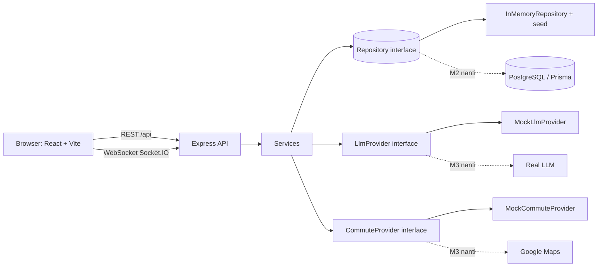

# PRD: KosMatch Jakarta — Inisialisasi Project

> **Versi:** 1.0 | **Tim:** Group 04 | **Dosen:** Prof. Dr. Ir. Riri Fitri Sari, M.M., M.Sc.
> **Anggota:** Satrio Atalla R, Fernanda Raeka YP, Tomas Warren Wuisang
> **Dokumen ini dipakai sebagai konteks utama untuk prompting di Antigravity.**

[TOC]

---

## 1. Ringkasan

**KosMatch Jakarta** adalah web app untuk mencari dan membandingkan kos di Jakarta berdasarkan **harga sewa** dan **estimasi waktu serta biaya perjalanan** ke kampus atau kantor. Fitur utama: AI Chatbot pencarian (bahasa natural), chat real-time penyewa ↔ pemilik, bookmark kos, dan CI/CD.

### 1.1 Strategi: "Visible-First"

:::warning
**Prioritas fase ini: aplikasi harus sudah bisa dilihat dan dijalankan, dan semua tombol yang diklik harus berhasil (tidak error, tidak blank).**
:::

Keputusan yang sudah ditetapkan:

| Hal | Keputusan |
|---|---|
| **LLM API** | **TIDAK diintegrasikan dulu.** Diganti `MockLlmProvider` (rule-based). Provider asli dipilih dan dipasang sendiri oleh owner project nanti. |
| **Google Maps API** | **TIDAK diintegrasikan dulu.** Diganti `MockCommuteProvider` (hitungan deterministik dari koordinat). |
| **Database (PostgreSQL)** | **DITUNDA.** Fase ini pakai **in-memory store + seed data** di balik interface repository, supaya nanti bisa diganti ke PostgreSQL/Prisma tanpa mengubah route atau service. |
| **Frontend + Backend** | **WAJIB jalan end-to-end.** Klik apa pun → ada respons sukses. |
| **Tampilan** | Mengikuti GUI dan warna di dokumen (Bab 3.9). |

:::danger
**Jangan** menulis kode yang memanggil Google Maps atau LLM sungguhan, jangan meminta API key, dan jangan menginstal SDK-nya. Cukup sediakan interface dan mock. Kalau ada keraguan, pilih mock.
:::

### 1.2 Milestone

| Milestone | Isi | Status |
|---|---|---|
| **M1 — Visible & Clickable** | Semua halaman tampil, semua tombol berfungsi dengan mock | **Cakupan PRD ini** |
| M2 — Real Database | Ganti in-memory repo ke PostgreSQL + Prisma | Nanti |
| M3 — Real AI & Maps | Pasang LLM dan Google Maps (dipilih owner) | Nanti |
| M4 — Deploy | Hosting cloud, CI/CD deploy, UAT | Nanti |

---

## 2. Tujuan & Non-Tujuan

### 2.1 Tujuan (M1)
1. Monorepo berjalan dengan satu perintah: `pnpm install && pnpm dev`.
2. Landing page, chatbot overlay, login/register, hasil pencarian, detail kos, bookmark, chat real-time, dan dashboard owner **tampil sesuai desain**.
3. Setiap tombol/aksi memberi umpan balik sukses (data berubah, navigasi, atau toast).
4. Chat real-time benar-benar bekerja antar dua browser (Socket.IO).
5. Chatbot membalas dengan hasil kos yang masuk akal dari **seed data**, lengkap dengan estimasi waktu dan biaya (mock).
6. CI (lint, typecheck, test, build) berjalan di GitHub Actions.

### 2.2 Non-Tujuan (M1)
- Integrasi LLM sungguhan.
- Integrasi Google Maps sungguhan.
- PostgreSQL, Prisma, dan migrasi.
- Deploy ke cloud, domain, dan HTTPS produksi.
- Notifikasi push, pembayaran, upload foto sungguhan (pakai placeholder), dan fitur compare kos (backlog).

---

## 3. Tech Stack

| Layer | Teknologi | Catatan |
|---|---|---|
| Bahasa | **TypeScript** | Frontend dan backend |
| Package manager | **pnpm workspaces** | Monorepo |
| Frontend | **React 18 + Vite** | SPA, tanpa SSR |
| Routing | **React Router v6** | |
| Styling | **Tailwind CSS** | Warna tema jadi design token |
| State/data | **TanStack Query** (server state) + **Zustand** (auth, UI state) | |
| Form | **React Hook Form + Zod** | |
| Ikon | **lucide-react** | |
| Backend | **Node.js + Express** | REST |
| Real-time | **Socket.IO** | Reconnect otomatis |
| Validasi | **Zod** | Skema dipakai bersama via `packages/shared` |
| Auth | **JWT + bcryptjs** | Role `tenant` / `owner` |
| Data (M1) | **In-memory store + seed** | Di balik interface `Repository` |
| Test | **Vitest**, **Supertest**, **Playwright** (smoke) | |
| Lint/format | **ESLint + Prettier** | |
| CI | **GitHub Actions** | |
| DB (M2, nanti) | PostgreSQL + Prisma | **Belum dipasang** |
| AI/Maps (M3, nanti) | Dipilih owner | **Belum dipasang** |

---

## 4. Design System

Sumber: Bab 3.9 dokumen. Gaya **bersih, minimalis, terinspirasi Airbnb**.

### 4.1 Design Tokens

| Token | Hex | Pemakaian |
|---|---|---|
| `bg` | `#F5F5F5` | Latar halaman |
| `surface` | `#FFFFFF` | Card, panel, input |
| `text` | `#303841` | Teks utama |
| `text-muted` | `#6B7280` | Teks sekunder |
| `accent` (teal) | `#76ABAE` | Header chatbot, tombol sekunder, aksen |
| `primary` (oranye) | `#FF5722` | Tombol aksi utama, harga, highlight judul |
| `border` | `#E5E7EB` | Garis pembatas |
| `success` / `danger` | `#16A34A` / `#DC2626` | Toast |

**Tailwind config (`apps/web/tailwind.config.ts`):**

```ts
export default {
  content: ['./index.html', './src/**/*.{ts,tsx}'],
  theme: {
    extend: {
      colors: {
        bg: '#F5F5F5',
        surface: '#FFFFFF',
        ink: '#303841',
        muted: '#6B7280',
        accent: '#76ABAE',
        primary: '#FF5722',
        line: '#E5E7EB',
      },
      borderRadius: { card: '16px' },
      boxShadow: { card: '0 2px 12px rgba(48,56,65,0.08)' },
      fontFamily: { sans: ['Inter', 'system-ui', 'sans-serif'] },
    },
  },
}
```

### 4.2 Komponen Dasar (`apps/web/src/components/ui`)
`Button` (varian: primary oranye, accent teal, ghost), `Input`, `Select`, `Card`, `Badge`, `Modal`, `Toast`, `Skeleton`, `EmptyState`, `Avatar`, `Spinner`.

### 4.3 Aturan UI
- Judul hero: "Cari Kos Impian," warna `ink` dan **"Hemat Waktu Perjalanan"** warna `primary`.
- Tombol utama selalu oranye. Tombol "Cari Kos dengan AI Chatbot" memakai teal.
- Card kos: foto/placeholder, badge waktu tempuh, nama, lokasi, harga oranye per bulan, ikon bookmark.
- **Responsif:** desktop dan mobile web (breakpoint Tailwind `sm/md/lg`). Chatbot overlay menjadi full-screen di mobile.
- Semua aksi async punya **loading state** dan **toast** sukses/gagal.
- Semua teks UI dalam **Bahasa Indonesia**.
- Foto kos memakai **placeholder gradient** lokal (tanpa dependensi gambar eksternal).

---

## 5. Arsitektur



### 5.1 Prinsip Wajib
1. **Dependency inversion:** service hanya bergantung pada interface `Repository`, `LlmProvider`, dan `CommuteProvider`. Implementasi dipilih lewat factory berdasarkan env.
2. **Env flag:** `USE_MOCK_AI=true` dan `DATA_STORE=memory` (default). Nilai lain belum diimplementasikan, cukup lempar error yang jelas: `"Provider belum diimplementasikan"`.
3. **Respons mock jujur:** semua data komuter diberi `isEstimate: true` dan `source: "mock"`. UI menampilkan teks "Estimasi" (sesuai Bab 3.8).
4. **Validasi output LLM** dengan Zod sebelum dipakai query (sesuai Bab 3.8), walaupun saat ini outputnya dari mock.
5. **Chatbot hanya memakai data platform**: hasil selalu berasal dari repository kos.

### 5.2 Struktur Repo

```
kosmatch/
├─ apps/
│  ├─ web/                      # React + Vite
│  │  ├─ src/
│  │  │  ├─ main.tsx, App.tsx, routes.tsx
│  │  │  ├─ api/                # axios client + hooks TanStack Query
│  │  │  ├─ stores/             # zustand: auth, ui, chatbot
│  │  │  ├─ components/
│  │  │  │  ├─ ui/              # Button, Input, Modal, Toast, ...
│  │  │  │  ├─ layout/          # Navbar, Footer, ProtectedRoute
│  │  │  │  ├─ kos/             # KosCard, KosGrid, SearchBar, BookmarkButton
│  │  │  │  ├─ chatbot/         # ChatbotOverlay, MessageBubble, ResultCard
│  │  │  │  └─ chat/            # ConversationList, ChatRoom, MessageInput
│  │  │  ├─ pages/              # Landing, Search, KosDetail, Login, Register,
│  │  │  │                      # Bookmarks, ChatPage, OwnerDashboard, OwnerKosForm,
│  │  │  │                      # Notifications, NotFound
│  │  │  └─ lib/                # format rupiah, socket client, utils
│  │  └─ tailwind.config.ts, vite.config.ts
│  └─ api/                      # Express
│     └─ src/
│        ├─ index.ts, app.ts, socket.ts, config.ts
│        ├─ routes/             # auth, kos, destinations, chatbot, commute,
│        │                      # bookmarks, chats, owner, health
│        ├─ services/           # authService, kosService, chatbotService, ...
│        ├─ middleware/         # auth (JWT), requireRole, validate, errorHandler
│        ├─ providers/
│        │  ├─ llm/             # LlmProvider.ts, MockLlmProvider.ts, index.ts
│        │  └─ commute/         # CommuteProvider.ts, MockCommuteProvider.ts, index.ts
│        └─ data/
│           ├─ repository.ts    # interface Repository
│           ├─ inMemoryRepository.ts
│           └─ seed.ts
├─ packages/
│  └─ shared/                   # Zod schema + tipe TS dipakai FE dan BE
│     └─ src/ (schemas.ts, types.ts, constants.ts)
├─ .github/workflows/ci.yml
├─ .env.example
├─ pnpm-workspace.yaml, package.json, tsconfig.base.json
├─ AGENTS.md                    # aturan untuk agent (lihat bagian 12.1)
└─ README.md
```

**Port:** web `5173`, api `4000`. Vite proxy `/api` dan `/socket.io` ke `http://localhost:4000`.

---

## 6. Model Data

Mengikuti Class Diagram (Bab 3.3). Field tambahan ditandai (+).

### 6.1 Tipe (`packages/shared/src/types.ts`)

```ts
export type Role = 'tenant' | 'owner';

export interface User {
  id: string;            // UUID
  nama: string;
  email: string;
  passwordHash: string;  // jangan pernah dikirim ke client
  role: Role;
}

export interface Kos {
  id: string;
  ownerId: string;
  namaKos: string;
  hargaSewa: number;     // Rupiah per bulan
  latitude: number;
  longitude: number;
  area: string;          // (+) mis. "Kemang, Jakarta Selatan"
  tipe: 'putra' | 'putri' | 'campur';   // (+)
  fasilitas: string[];   // (+)
  deskripsi: string;     // (+)
  rating: number;        // (+) 0-5
  fotoColor: string;     // (+) warna gradient placeholder
}

export interface ChatHistory {
  id: string;
  senderId: string;
  receiverId: string;
  pesan: string;
  sentAt: string;        // ISO
}

export interface Bookmark {
  id: string;
  userId: string;
  kosId: string;
  createdAt: string;
}

export interface Destination {   // (+) kampus / kantor / stasiun
  id: string;
  nama: string;
  kategori: 'kampus' | 'kantor' | 'stasiun';
  latitude: number;
  longitude: number;
  aliases: string[];     // untuk mock parser, mis. ["ui", "universitas indonesia"]
}

export type TransportMode = 'ojek' | 'transit' | 'jalan_kaki';

export interface CommuteEstimate {
  destinationId: string;
  mode: TransportMode;
  distanceKm: number;
  durationMin: number;
  costRp: number;        // biaya sekali jalan
  transitTransfers: number;
  isEstimate: true;
  source: 'mock';        // nanti 'google_maps'
}
```

### 6.2 Interface Repository

```ts
export interface Repository {
  users: {
    findByEmail(email: string): Promise<User | null>;
    findById(id: string): Promise<User | null>;
    create(u: Omit<User, 'id'>): Promise<User>;
  };
  kos: {
    list(filter?: { maxPrice?: number; q?: string; tipe?: string }): Promise<Kos[]>;
    get(id: string): Promise<Kos | null>;
    listByOwner(ownerId: string): Promise<Kos[]>;
    create(k: Omit<Kos, 'id'>): Promise<Kos>;
    update(id: string, patch: Partial<Kos>): Promise<Kos | null>;
    remove(id: string): Promise<boolean>;
  };
  destinations: { list(): Promise<Destination[]>; get(id: string): Promise<Destination | null>; };
  bookmarks: {
    listByUser(userId: string): Promise<Bookmark[]>;
    add(userId: string, kosId: string): Promise<Bookmark>;      // idempotent
    remove(userId: string, kosId: string): Promise<boolean>;
  };
  chats: {
    between(a: string, b: string): Promise<ChatHistory[]>;
    conversations(userId: string): Promise<{ otherUserId: string; last: ChatHistory }[]>;
    add(m: Omit<ChatHistory, 'id' | 'sentAt'>): Promise<ChatHistory>;
  };
}
```

### 6.3 Seed Data (fiktif, untuk demo)

**Akun demo** (password semua: `password123`):

| Nama | Email | Role |
|---|---|---|
| Demo Penyewa | `tenant@kosmatch.test` | tenant |
| Demo Penyewa 2 | `tenant2@kosmatch.test` | tenant |
| Bu Sari (Pemilik) | `owner@kosmatch.test` | owner |
| Pak Budi (Pemilik) | `owner2@kosmatch.test` | owner |

**Destinasi (minimal 10):**

| Nama | Kategori | Lat | Lng | Alias |
|---|---|---|---|---|
| Universitas Indonesia (Depok) | kampus | -6.3620 | 106.8270 | ui, universitas indonesia |
| Binus Kemanggisan | kampus | -6.2010 | 106.7820 | binus, kemanggisan |
| Universitas Trisakti | kampus | -6.1680 | 106.7920 | trisakti, grogol |
| UNJ Rawamangun | kampus | -6.1950 | 106.8830 | unj, rawamangun |
| Atma Jaya Semanggi | kampus | -6.2190 | 106.8160 | atma jaya, semanggi |
| SCBD | kantor | -6.2270 | 106.8100 | scbd |
| Sudirman / Thamrin | kantor | -6.2030 | 106.8230 | sudirman, thamrin |
| Kuningan | kantor | -6.2330 | 106.8300 | kuningan |
| Stasiun Sudirman | stasiun | -6.2025 | 106.8230 | stasiun sudirman |
| Stasiun Tebet | stasiun | -6.2260 | 106.8580 | stasiun tebet |
| Stasiun Palmerah | stasiun | -6.2080 | 106.7980 | stasiun palmerah, palmerah |

**Kos (minimal 12, dimiliki 2 owner):**

| Nama | Area | Harga/bln | Lat | Lng | Tipe |
|---|---|---|---|---|---|
| Kos Andalan UI | Depok | 1.800.000 | -6.3640 | 106.8320 | campur |
| Kos Eksekutif Sudirman | Tanah Abang | 4.500.000 | -6.2230 | 106.8190 | campur |
| Kos Nyaman Kemang | Kemang | 3.200.000 | -6.2610 | 106.8130 | putri |
| Kos Harmoni Kuningan | Kuningan | 3.800.000 | -6.2300 | 106.8300 | campur |
| Kos Melati Kemanggisan | Kemanggisan | 2.200.000 | -6.2010 | 106.7840 | putri |
| Kos Rawamangun Asri | Rawamangun | 1.700.000 | -6.1950 | 106.8820 | putra |
| Kos Tebet Hijau | Tebet | 2.500.000 | -6.2260 | 106.8570 | campur |
| Kos Semanggi Pratama | Semanggi | 3.000.000 | -6.2190 | 106.8080 | putra |
| Kos Grogol Prima | Grogol | 2.000.000 | -6.1660 | 106.7900 | putra |
| Kos Setiabudi Residence | Setiabudi | 3.500.000 | -6.2150 | 106.8300 | campur |
| Kos Kebayoran Cozy | Kebayoran | 2.900.000 | -6.2440 | 106.7990 | putri |
| Kos Pancoran Mandiri | Pancoran | 2.400.000 | -6.2440 | 106.8450 | putra |

Setiap kos: 3–6 fasilitas (AC, WiFi, kamar mandi dalam, dapur bersama, parkir, laundry), deskripsi 2 kalimat, rating 3.8–4.9, `fotoColor` bervariasi.

**Seed percakapan:** satu percakapan awal antara `tenant@kosmatch.test` dan `owner@kosmatch.test` (3 pesan) agar halaman chat tidak kosong. **Seed bookmark:** 2 bookmark untuk `tenant@kosmatch.test`.

---

## 7. Mock Provider (Penting)

### 7.1 `CommuteProvider`

```ts
export interface CommuteProvider {
  estimate(kos: Kos, dest: Destination, mode?: TransportMode): Promise<CommuteEstimate[]>;
}
```

**`MockCommuteProvider` (deterministik, tanpa jaringan):**
1. `straight = haversine(kos, dest)` dalam km.
2. `distanceKm = round1(straight × 1.3)` (faktor jalan berkelok).
3. Per mode:

| Mode | Kecepatan | Biaya | Transfer |
|---|---|---|---|
| `ojek` | 22 km/jam | `max(8000, round(3000 × km / 500) × 500)` | 0 |
| `transit` | 28 km/jam + 10 menit tunggu | `min(10000, 3000 + 300 × km)` dibulatkan ke 500 | `km < 5 ? 0 : km < 15 ? 1 : 2` |
| `jalan_kaki` | 4.5 km/jam | 0 | 0 (hanya jika `km ≤ 1.5`) |

4. `durationMin = ceil(km / speed × 60 + waitMin)`.
5. Selalu kembalikan `isEstimate: true`, `source: 'mock'`.

### 7.2 `LlmProvider`

```ts
export interface ChatParams {
  destinationId?: string;      // hasil match alias destinasi
  maxBudgetMonthly?: number;   // Rp / bulan
  maxCommuteMin?: number;
  maxCommuteCostRp?: number;   // mis. "ojek < 15rb"
  preferredMode?: TransportMode;
  tipe?: 'putra' | 'putri' | 'campur';
}
export interface LlmProvider {
  extractParams(message: string, destinations: Destination[]): Promise<ChatParams>;
  composeReply(params: ChatParams, resultCount: number): Promise<string>;
}
```

**`MockLlmProvider` (rule-based/regex):**
- **Budget:** pola angka + satuan. `jt|juta` → ×1.000.000, `rb|ribu|k` → ×1.000. Angka ≥ 500.000 atau satuan `jt/juta` dianggap budget sewa bulanan. Angka kecil dengan `rb/ribu/k` dikaitkan ke biaya perjalanan jika ada kata `ojek|ongkos|transport|biaya perjalanan`.
- **Waktu:** `(\d+)\s*(menit|mnt|min)` → `maxCommuteMin`.
- **Destinasi:** cocokkan alias (case-insensitive, substring).
- **Mode:** `ojek`, `krl|kereta|transit|bus|transjakarta`, `jalan kaki`.
- **Tipe:** `putra|cowok|laki`, `putri|cewek|perempuan`.
- **Contoh:** "Kos dekat stasiun sudirman, ojek < 15rb" → `destinationId=stasiun-sudirman`, `maxCommuteCostRp=15000`, `preferredMode=ojek`.
- Jika tidak ada destinasi dan tidak ada budget → `composeReply` meminta klarifikasi ("Mau ke kampus atau kantor mana, dan berapa budget sewa per bulan?").
- Output **harus lolos validasi Zod** `ChatParamsSchema`.

### 7.3 Alur `POST /api/chatbot` (M1)
1. Wajib login (JWT). Tanpa token → 401 (frontend mengarahkan ke `/login`, sesuai Activity Diagram).
2. `llm.extractParams` → validasi Zod.
3. Ambil kos dari repo (filter `maxBudgetMonthly`, `tipe`).
4. Untuk tiap kos, `commute.estimate` ke destinasi. Terapkan filter `maxCommuteMin` dan `maxCommuteCostRp`.
5. Urutkan berdasarkan skor sederhana (waktu tempuh + harga). Ambil 5 teratas.
6. `llm.composeReply`. Kembalikan `{ reply, params, results, noResults }`.
7. `noResults: true` → UI menampilkan "Kos Tidak Ditemukan" dan saran merevisi permintaan.

---

## 8. API Contract

**Envelope:** sukses `{ "ok": true, "data": ... }`, gagal `{ "ok": false, "error": { "code": "...", "message": "..." } }`.
**Auth:** header `Authorization: Bearer <jwt>`. Token berlaku 7 hari. Payload `{ sub, role }`.

| Method | Path | Auth | Deskripsi |
|---|---|---|---|
| GET | `/api/health` | – | `{ status: 'ok', mode: { ai: 'mock', data: 'memory' } }` |
| POST | `/api/auth/register` | – | `{ nama, email, password, role }` → `{ token, user }` |
| POST | `/api/auth/login` | – | `{ email, password }` → `{ token, user }` |
| GET | `/api/auth/me` | ✔ | User saat ini |
| GET | `/api/destinations` | – | Daftar destinasi |
| GET | `/api/kos` | – | Query: `q`, `maxPrice`, `tipe`, `destinationId` (jika ada → sertakan `commute`) |
| GET | `/api/kos/:id` | – | Detail + `commute` ke destinasi jika `?destinationId=` |
| GET | `/api/commute` | – | `?kosId=&destinationId=` → `CommuteEstimate[]` (mock) |
| POST | `/api/chatbot` | ✔ tenant | `{ message }` → `{ reply, params, results[], noResults }` |
| GET | `/api/bookmarks` | ✔ | Kos yang disimpan (objek Kos lengkap) |
| POST | `/api/bookmarks` | ✔ | `{ kosId }` → idempotent |
| DELETE | `/api/bookmarks/:kosId` | ✔ | Hapus bookmark |
| GET | `/api/chats/conversations` | ✔ | Daftar percakapan |
| GET | `/api/chats/:otherUserId` | ✔ | Riwayat pesan |
| POST | `/api/chats/:otherUserId` | ✔ | Kirim pesan via REST (fallback) |
| GET | `/api/owner/kos` | ✔ owner | Kos milik owner |
| POST | `/api/owner/kos` | ✔ owner | Tambah kos |
| PUT | `/api/owner/kos/:id` | ✔ owner (pemilik) | Ubah kos |
| DELETE | `/api/owner/kos/:id` | ✔ owner (pemilik) | Hapus kos |

**Kode error standar:** `VALIDATION_ERROR` (400), `UNAUTHORIZED` (401), `FORBIDDEN` (403), `NOT_FOUND` (404), `INTERNAL` (500). Error handler terpusat, **tidak boleh** membocorkan stack trace ke client.

### 8.1 Contoh Respons Chatbot

```json
{
  "ok": true,
  "data": {
    "reply": "Saya menemukan 3 kos dekat Stasiun Sudirman dengan ojek di bawah Rp15.000. Estimasi ini bersifat perkiraan, mohon verifikasi sebelum memutuskan.",
    "params": { "destinationId": "stasiun-sudirman", "maxCommuteCostRp": 15000, "preferredMode": "ojek" },
    "results": [
      {
        "kos": { "id": "…", "namaKos": "Kos Setiabudi Residence", "hargaSewa": 3500000, "area": "Setiabudi" },
        "commute": [{ "mode": "ojek", "distanceKm": 1.9, "durationMin": 5, "costRp": 8000, "transitTransfers": 0, "isEstimate": true, "source": "mock" }]
      }
    ],
    "noResults": false
  }
}
```

### 8.2 Socket.IO (Chat Real-Time)

- **Koneksi:** `io(url, { auth: { token } })`. Server memverifikasi JWT di middleware handshake. Tiap user otomatis join room `user:{id}`.
- **Client → Server:** `message:send` dengan `{ receiverId, pesan }` dan ack callback `{ ok, message }`.
- **Server → Client:** `message:new` dengan `ChatHistory`, dikirim ke room `user:{receiverId}` dan `user:{senderId}` (supaya multi-tab sinkron).
- **Opsional:** `typing` `{ toUserId, isTyping }`.
- Pesan disimpan lewat `repository.chats.add` sebelum di-emit.
- **Reconnect:** `reconnection: true` di client, dengan indikator status ("Terhubung" / "Menghubungkan ulang…").
- Validasi: `pesan` tidak kosong, maks 1000 karakter. Tolak pengiriman ke diri sendiri.

---

## 9. Halaman & Perilaku UI

| Route | Halaman | Akses | Isi |
|---|---|---|---|
| `/` | Landing | Publik | Navbar (Beranda, Cari Kos, Tersimpan, Notifikasi, tombol **Masuk** oranye), hero, tombol teal "Cari Kos dengan AI Chatbot", search bar multi-parameter, grid "Rekomendasi Kos Populer" |
| `/cari` | Hasil Pencarian | Publik | Search bar + grid kos + filter. Query dari landing |
| `/kos/:id` | Detail Kos | Publik | Info kos, fasilitas, estimasi komuter (pilih destinasi), tombol Bookmark, tombol **Chat Pemilik** |
| `/login`, `/register` | Auth | Publik | Form + tombol "Masuk sebagai Demo Penyewa" / "Demo Pemilik" |
| `/bookmark` | Tersimpan | Login | Grid kos tersimpan + empty state |
| `/chat`, `/chat/:userId` | Chat | Login | Daftar percakapan kiri, ruang chat kanan |
| `/notifikasi` | Notifikasi | Login | Empty state "Belum ada notifikasi" (placeholder) |
| `/owner` | Kelola Kos | Owner | Tabel kos milik sendiri + Tambah/Ubah/Hapus |
| `/owner/kos/new`, `/owner/kos/:id/edit` | Form Kos | Owner | Form kos dengan validasi |
| `*` | 404 | – | Halaman tidak ditemukan + tombol kembali |

### 9.1 Landing Page
- Hero: judul "Cari Kos Impian, **Hemat Waktu Perjalanan**" dengan subjudul tentang menemukan kos berdasarkan budget dan estimasi waktu tempuh ke kampus/kantor.
- **Search bar** tiga field: **Lokasi Tujuan** (select destinasi), **Waktu Tempuh Maks** (select 15/30/45/60 menit), **Budget Sewa** (select rentang). Tombol bulat oranye berikon cari → navigasi ke `/cari?...`.
- **Grid populer:** 4 kos teratas berdasarkan rating, dengan badge, nama, area, harga oranye, tombol bookmark.
- Klik "Cari Kos dengan AI Chatbot" → buka overlay chatbot. Jika belum login → `/login?redirect=/` lalu otomatis membuka chatbot setelah login.

### 9.2 AI Chatbot Overlay
- Panel samping **kanan**, latar halaman di belakang diberi overlay gelap. Header **teal** "KosMatch AI" dengan tombol X. Mobile: full-screen.
- Pesan pembuka bot: sapaan + contoh ("Contoh: *Cari kos dekat Stasiun Sudirman, ojek di bawah 15rb, budget 3 juta*").
- Bubble user: gelap (`ink`), teks putih, rata kanan. Bubble bot: putih, rata kiri.
- Input di bawah dengan tombol kirim bulat oranye. Enter mengirim, Shift+Enter baris baru.
- Saat menunggu: indikator mengetik. Hasil ditampilkan sebagai **ResultCard** kecil di dalam percakapan (nama, harga, waktu & biaya komuter, tombol "Lihat Detail" dan bookmark).
- `noResults` → bubble "Kos Tidak Ditemukan" + saran merevisi.
- Footer kecil: "Estimasi dapat berubah. Mohon verifikasi sebelum memutuskan."
- Riwayat percakapan disimpan di Zustand selama sesi.

### 9.3 Chat Real-Time (Fitur Chatting User & Owner)
- Kiri: daftar percakapan (avatar, nama, pesan terakhir, waktu). Kanan: ruang chat dengan bubble kiri/kanan, auto-scroll, input + tombol kirim, indikator status koneksi.
- Dari Detail Kos, "Chat Pemilik" membuka `/chat/:ownerId`.
- Owner dan tenant sama-sama melihat pesan masuk **tanpa refresh**.

### 9.4 Bookmark (Fitur Bookmark Kos)
- Ikon bookmark di KosCard/Detail: klik = toggle dengan **optimistic update** + toast "Disimpan" / "Dihapus dari tersimpan". Belum login → arahkan ke login.
- Halaman `/bookmark`: grid kos tersimpan, bisa dihapus langsung, empty state dengan tombol "Cari Kos".

### 9.5 Owner Dashboard
- Tabel kos (nama, area, harga, rating) + tombol Ubah/Hapus (dengan konfirmasi modal) + tombol "Tambah Kos" oranye.
- Form: nama, area, harga, lat/lng, tipe, fasilitas (multi-select), deskripsi. Validasi Zod. Simpan → toast sukses → kembali ke tabel.
- Link "Pesan Masuk" ke `/chat`.

---

## 10. Pemetaan ke Tugas Jira

Acuan PRD ini adalah lima tugas utama di Jira beserta subtask-nya. Output M1 dibuat mengikuti isi tugas tersebut.

### 10.1 Tugas Utama

| Tugas | Prioritas | Hasil di M1 |
|---|---|---|
| **Fitur Chatbot AI Pencarian Kos** | Highest | Chatbot lengkap dengan **mock LLM + mock komuter** |
| **Fitur Chatting User & Owner** | Highest | Chat real-time sungguhan (Socket.IO), data in-memory |
| **Fitur Bookmark Kos** | Medium | REST + UI sungguhan, data in-memory |
| **Infrastruktur CI/CD & Peluncuran** | High | Repo + pipeline CI (lint/test/build). Deploy ditunda (M4) |
| **Desain UI/UX & Tampilan Chatbot AI** | – | Seluruh UI sesuai desain di dokumen |

### 10.2 Subtask

| Subtask | Bidang | Status di M1 |
|---|---|---|
| Desain UI/UX & Tampilan Chatbot AI | Frontend | ✅ Dikerjakan (Prompt 7–8) |
| Integrasi LLM & Google Maps API | Backend | ⏸ Hanya interface + mock. Integrasi asli = M3 |
| Pengujian Akurasi Data AI Chatbot | QA | ⚠ Unit test parser mock saja. Uji akurasi asli = M3 |
| Desain UI/UX Ruang Chatting | Frontend | ✅ Dikerjakan (Prompt 9) |
| Perancangan Skema Database Chat | DBA | ⏸ Tipe `ChatHistory` + interface repo. Skema SQL = M2 |
| Pembuatan Endpoint WebSocket & REST | Backend | ✅ Dikerjakan (Prompt 6) |
| Desain UI/UX Halaman Bookmark | Frontend | ✅ Dikerjakan (Prompt 9) |
| Perancangan Skema Database Bookmark | DBA | ⏸ Tipe `Bookmark` + interface repo. Skema SQL = M2 |
| Pembuatan Endpoint API Bookmark | Backend | ✅ Dikerjakan (Prompt 5) |
| Setup Repository & Pipeline CI/CD | DevOps | ✅ Repo + CI (Prompt 1 & 10) |
| Setup Cloud Hosting & Database Server | DevOps | ⏸ M4 |
| User Acceptance Testing (UAT) & Rilis | QA | ⏸ M4. Smoke test M1 ada di bagian 13 |

---

## 11. Acceptance Criteria per Fitur

### 11.1 Fitur Chatbot AI Pencarian Kos (mock)
- [ ] Tombol "Cari Kos dengan AI Chatbot" membuka overlay kanan dengan header teal.
- [ ] User belum login diarahkan ke `/login`, lalu kembali dan chatbot terbuka.
- [ ] Input "Cari kos dekat UI budget 2 juta" menghasilkan ≥1 hasil (misal Kos Andalan UI) dengan estimasi komuter.
- [ ] Input "kos dekat stasiun sudirman, ojek < 15rb" menghasilkan hasil yang biaya ojeknya ≤ Rp15.000.
- [ ] Input tak bermakna ("halo") memicu pertanyaan klarifikasi, **bukan error**.
- [ ] Input yang tidak cocok data (budget 100 ribu) menampilkan **"Kos Tidak Ditemukan"**.
- [ ] Setiap estimasi berlabel "Estimasi", respons API memuat `source: "mock"`.
- [ ] Tidak ada request keluar ke domain Google/LLM (verifikasi di tab Network).
- [ ] Unit test `MockLlmProvider` (≥10 kasus) dan `MockCommuteProvider` lulus.

### 11.2 Fitur Chatting User & Owner
- [ ] Dua browser (tenant dan owner) bertukar pesan tanpa refresh.
- [ ] Pesan tersimpan dan tampil lagi setelah halaman di-refresh (selama server hidup).
- [ ] Socket tanpa token valid ditolak.
- [ ] Putus-sambung koneksi: indikator berubah dan otomatis tersambung kembali.
- [ ] Tombol "Chat Pemilik" di detail kos membuka percakapan dengan owner yang benar.

### 11.3 Fitur Bookmark Kos
- [ ] Klik ikon bookmark → tersimpan, ikon terisi, toast muncul.
- [ ] Klik lagi → terhapus. Menyimpan dua kali tidak membuat duplikat.
- [ ] `/bookmark` menampilkan daftar yang benar dan empty state saat kosong.
- [ ] Bookmark user A tidak terlihat oleh user B.

### 11.4 Infrastruktur CI/CD & Peluncuran
- [ ] Workflow GitHub Actions berjalan pada PR dan push ke `main`: install → lint → typecheck → test → build.
- [ ] Status check wajib lulus sebelum merge.
- [ ] README berisi cara menjalankan lokal dan struktur proyek.

### 11.5 Desain UI/UX & Tampilan Chatbot AI
- [ ] Warna sesuai token (bagian 4.1), tombol utama oranye, aksen teal.
- [ ] Layout responsif di lebar 375px, 768px, dan 1280px tanpa scroll horizontal.
- [ ] Semua halaman di bagian 9 dapat dibuka tanpa error console.
- [ ] Setiap aksi async punya loading state dan toast.

### 11.6 Umum (Owner Dashboard & Auth)
- [ ] Register, login, dan logout berfungsi. Tenant tidak bisa membuka `/owner` (redirect ke `/`).
- [ ] Owner bisa tambah, ubah, hapus kos miliknya. Tidak bisa mengubah kos owner lain (403).

---

## 12. Panduan Prompting Antigravity

### 12.1 Aturan Agent (simpan sebagai `AGENTS.md` di root repo)

```md
# Aturan untuk Agent — KosMatch Jakarta

1. Baca PRD (docs/PRD.md) sebelum mengerjakan tugas apa pun.
2. Bahasa UI: Bahasa Indonesia. Kode, nama variabel, dan komentar: Inggris.
3. DILARANG memanggil Google Maps API atau LLM API sungguhan. Jangan instal SDK-nya,
   jangan minta API key. Gunakan MockLlmProvider dan MockCommuteProvider.
4. DILARANG memasang PostgreSQL/Prisma di fase M1. Gunakan InMemoryRepository
   di balik interface Repository.
5. Service hanya boleh bergantung pada interface (Repository, LlmProvider, CommuteProvider).
6. Semua input API divalidasi Zod. Skema ada di packages/shared.
7. Jangan pernah mengirim passwordHash ke client.
8. Palet warna hanya dari design tokens Tailwind (bg, surface, ink, muted, accent, primary, line).
9. Setiap tombol harus bekerja. Jangan menambahkan tombol dummy tanpa handler.
10. Setelah tiap prompt selesai: jalankan `pnpm lint && pnpm typecheck && pnpm test && pnpm build`
    dan perbaiki sampai hijau. Laporkan apa yang dibuat.
11. TypeScript strict. Tidak ada `any` kecuali dengan komentar alasan.
12. Commit kecil dengan pesan Conventional Commits (feat:, fix:, chore:, test:).
```

### 12.2 Urutan Prompt

Jalankan **berurutan**. Tempel PRD ini sebagai konteks di awal, lalu satu prompt per sesi. Pastikan hijau sebelum lanjut.

#### Prompt 0 — Konteks
```text
Saya akan membangun project "KosMatch Jakarta". Baca PRD lengkap berikut sebagai
sumber kebenaran tunggal. Patuhi bagian 1.1 (Visible-First) dan 12.1 (Aturan Agent).
Jangan menulis kode dulu. Balas dengan ringkasan pemahamanmu (maks 10 poin) dan
daftar asumsi/pertanyaan jika ada.
[TEMPEL PRD]
```

#### Prompt 1 — Scaffold Monorepo (Setup Repository & Pipeline CI/CD)
```text
Buat monorepo pnpm sesuai PRD bagian 5.2: apps/web (React+Vite+TS+Tailwind),
apps/api (Express+TS, jalankan dengan tsx), packages/shared (Zod + tipe).
Konfigurasi: tsconfig.base.json (strict), ESLint, Prettier, Vitest di semua paket,
Vite proxy /api dan /socket.io ke :4000, skrip root `pnpm dev` (jalankan web dan api
bersamaan, mis. dengan concurrently), `pnpm lint`, `pnpm typecheck`, `pnpm test`, `pnpm build`.
Tambahkan .env.example (USE_MOCK_AI=true, DATA_STORE=memory, JWT_SECRET, PORT=4000)
dan simpan PRD di docs/PRD.md serta aturan agent di AGENTS.md.
Endpoint GET /api/health harus berfungsi. Halaman web awal menampilkan hasil health check.
DoD: `pnpm dev` jalan, halaman menampilkan "API: ok (mock)".
```

#### Prompt 2 — Shared Types, Seed, Repository
```text
Implementasikan PRD bagian 6: semua tipe dan skema Zod di packages/shared,
interface Repository, InMemoryRepository, dan seed.ts lengkap (akun demo, 11 destinasi,
12 kos, 3 pesan chat, 2 bookmark). Password di-hash dengan bcryptjs saat seeding.
Tambahkan unit test untuk InMemoryRepository (CRUD kos, bookmark idempoten, chat between).
DoD: test hijau, tidak ada dependensi database.
```

#### Prompt 3 — Backend Inti
```text
Implementasikan backend inti sesuai PRD bagian 8: envelope respons, error handler terpusat,
middleware validate (Zod), JWT auth + requireRole, route auth (register/login/me),
destinations, kos (list dengan filter q/maxPrice/tipe, detail), owner CRUD kos
(hanya pemilik), health. Pakai factory untuk memilih repository berdasarkan DATA_STORE.
Tulis test Supertest untuk alur: register → login → me, akses tanpa token (401),
tenant akses owner route (403), owner ubah kos orang lain (403).
```

#### Prompt 4 — Mock Provider & Chatbot (Fitur Chatbot AI + Integrasi LLM & Maps versi mock)
```text
Implementasikan PRD bagian 7: interface LlmProvider dan CommuteProvider,
MockLlmProvider (regex parser), MockCommuteProvider (haversine, rumus tabel 7.1),
factory berdasar USE_MOCK_AI, route GET /api/commute dan POST /api/chatbot (tenant, JWT).
Validasi output extractParams dengan Zod. Jika USE_MOCK_AI=false, lempar error
"Provider belum diimplementasikan" (jangan implementasi provider nyata).
Tulis minimal 10 test untuk parser (budget "2 juta", "15rb", waktu "30 menit",
alias destinasi, tipe, input kosong, input tak bermakna) dan 5 test untuk estimator.
Tulis juga 3 test end-to-end endpoint chatbot (ada hasil, tidak ada hasil, klarifikasi).
```

#### Prompt 5 — Bookmark (Endpoint API Bookmark)
```text
Implementasikan endpoint bookmark PRD bagian 8 (GET/POST/DELETE) dengan semantik idempoten
dan isolasi per user. GET mengembalikan objek Kos lengkap. Test Supertest:
tambah dua kali tidak duplikat, hapus yang tidak ada tetap sukses, user A tidak melihat milik B.
```

#### Prompt 6 — Chat Real-Time (Endpoint WebSocket & REST)
```text
Implementasikan Socket.IO sesuai PRD 8.2 beserta REST chat (conversations, history, send fallback).
Middleware handshake verifikasi JWT, room user:{id}, event message:send (dengan ack) dan message:new,
validasi pesan (1–1000 karakter), simpan ke repository sebelum emit.
Tulis test integrasi dengan socket.io-client: dua klien saling kirim pesan, socket tanpa token ditolak.
```

#### Prompt 7 — Frontend Fondasi + Landing (Desain UI/UX)
```text
Bangun fondasi frontend: Tailwind dengan design tokens PRD 4.1, komponen ui PRD 4.2,
Navbar (Beranda, Cari Kos, Tersimpan, Notifikasi, tombol Masuk oranye / menu user setelah login),
axios client, TanStack Query, Zustand auth store (token di localStorage), Toast, ProtectedRoute,
dan halaman Landing sesuai PRD 9.1 (hero, tombol teal chatbot, search bar 3 field dengan tombol
bulat oranye, grid Rekomendasi Kos Populer dari API). Buat halaman Login/Register dengan tombol
demo login. Responsif 375/768/1280. Foto kos = placeholder gradient dari fotoColor.
```

#### Prompt 8 — Chatbot Overlay (Tampilan Chatbot AI)
```text
Bangun ChatbotOverlay sesuai PRD 9.2: panel kanan dengan overlay gelap, header teal "KosMatch AI",
bubble user/bot, indikator mengetik, input dengan tombol kirim bulat oranye, ResultCard di dalam
percakapan, state "Kos Tidak Ditemukan", footer disclaimer estimasi, full-screen di mobile.
Hubungkan ke POST /api/chatbot. Jika belum login arahkan ke /login?redirect lalu buka chatbot otomatis
setelah login. Riwayat di Zustand.
```

#### Prompt 9 — Halaman Lain (Bookmark, Ruang Chatting, Halaman Bookmark)
```text
Bangun halaman: /cari (hasil + filter), /kos/:id (detail + estimasi komuter per destinasi +
Bookmark + Chat Pemilik), /bookmark (grid + empty state), /chat dan /chat/:userId
(Socket.IO client dengan reconnect dan indikator koneksi), /notifikasi (empty state),
/owner dan form tambah/ubah kos (modal konfirmasi hapus), 404.
BookmarkButton memakai optimistic update + toast. Semua sesuai PRD bagian 9 dan 11.
```

#### Prompt 10 — CI/CD & Dokumentasi
```text
Buat .github/workflows/ci.yml (Node 20, pnpm, cache; jalankan lint, typecheck, test, build pada PR dan push main).
Buat README.md: deskripsi, prasyarat, cara menjalankan, akun demo, struktur repo, skrip, dan bagian
"Cara mengganti ke provider nyata (M2/M3)" yang menjelaskan titik penggantian
(Repository, LlmProvider, CommuteProvider) tanpa mengimplementasikannya.
```

#### Prompt 11 — Smoke Test & Polish
```text
Tulis smoke test Playwright untuk Matriks Klik (PRD bagian 13) dan jalankan.
Perbaiki semua bug, error console, dan masalah responsif yang ditemukan.
Laporkan hasil tiap baris matriks.
```

---

## 13. Matriks "Semua Diklik Berhasil" (Smoke Test M1)

| # | Aksi | Hasil yang Diharapkan |
|---|---|---|
| 1 | Buka `/` | Landing tampil, grid kos terisi |
| 2 | Klik **Masuk** → "Masuk sebagai Demo Penyewa" | Login sukses, navbar menampilkan nama user |
| 3 | Klik **Cari Kos dengan AI Chatbot** | Overlay kanan terbuka |
| 4 | Kirim "Cari kos dekat UI budget 2 juta" | Bot membalas + ≥1 ResultCard |
| 5 | Kirim "kos dekat stasiun sudirman, ojek < 15rb" | Hasil dengan biaya ≤ 15rb |
| 6 | Kirim "halo" | Bot meminta klarifikasi |
| 7 | Kirim "kos 100 ribu di Depok" | "Kos Tidak Ditemukan" |
| 8 | Klik **Lihat Detail** pada ResultCard | `/kos/:id` terbuka |
| 9 | Klik ikon bookmark | Tersimpan + toast |
| 10 | Klik ikon bookmark lagi | Terhapus + toast |
| 11 | Buka **Tersimpan** | Daftar sesuai |
| 12 | Klik **Chat Pemilik** | `/chat/:ownerId` terbuka |
| 13 | Kirim pesan | Pesan muncul di ruang chat |
| 14 | Browser kedua: login owner, buka `/chat` | Pesan tenant tampil tanpa refresh, balasan owner masuk ke tenant |
| 15 | Search bar landing → klik tombol cari | `/cari` dengan hasil terfilter |
| 16 | Klik **Notifikasi** | Empty state tampil |
| 17 | Logout, buka `/bookmark` | Diarahkan ke login |
| 18 | Login sebagai owner → `/owner` | Tabel kos milik owner |
| 19 | Tambah kos baru | Muncul di tabel + toast sukses |
| 20 | Ubah, lalu hapus kos (dengan konfirmasi) | Perubahan tercermin di tabel |
| 21 | Login tenant, buka `/owner` | Diarahkan ke `/` |
| 22 | Buka URL ngawur | Halaman 404 |
| 23 | Resize ke 375px | Layout rapi, chatbot full-screen |
| 24 | Cek tab Network sepanjang uji | Tidak ada request ke Google/LLM |

---

## 14. CI/CD (Infrastruktur CI/CD & Peluncuran)

```yaml
# .github/workflows/ci.yml
name: CI
on:
  pull_request:
  push:
    branches: [main]
jobs:
  verify:
    runs-on: ubuntu-latest
    steps:
      - uses: actions/checkout@v4
      - uses: pnpm/action-setup@v4
        with: { version: 9 }
      - uses: actions/setup-node@v4
        with: { node-version: 20, cache: pnpm }
      - run: pnpm install --frozen-lockfile
      - run: pnpm lint
      - run: pnpm typecheck
      - run: pnpm test
      - run: pnpm build
```

**Branching:** `main` (stabil) ← `develop` ← `feat/<kan-id>-<nama>`. PR wajib lolos CI. Deploy otomatis ditambahkan di M4 (frontend Vercel/Netlify, backend Railway/Render).

---

## 15. Rencana Ganti ke Provider Nyata (M2–M3, bukan sekarang)

| Komponen | Cara Ganti | File yang Disentuh |
|---|---|---|
| Database | Buat `PrismaRepository implements Repository`, skema Prisma dari tipe bagian 6, set `DATA_STORE=postgres` | `data/`, factory |
| LLM | Buat `XxxLlmProvider implements LlmProvider` (output JSON, validasi Zod), set `USE_MOCK_AI=false` | `providers/llm/` |
| Google Maps | Buat `GoogleCommuteProvider implements CommuteProvider` + cache rute di DB | `providers/commute/` |
| Pengujian Akurasi Data AI Chatbot | Dataset prompt → parameter yang diharapkan, ukur akurasi parser dan filter komuter | `tests/accuracy/` |

Karena route dan service hanya bergantung pada interface, **tidak ada perubahan pada frontend maupun route** saat penggantian.

**Env tambahan M2/M3 (placeholder, jangan diisi sekarang):**
```bash
# DATABASE_URL=
# LLM_API_KEY=
# GOOGLE_MAPS_API_KEY=
```

---

## 16. Risiko & Mitigasi (M1)

| Risiko | Mitigasi |
|---|---|
| Agent terlanjur memasang SDK/API asli | Aturan 3–4 di `AGENTS.md`, cek tab Network (baris 24 matriks) |
| Data hilang saat server restart (in-memory) | Diterima di M1. Seed dimuat ulang tiap start. Dicatat di README |
| Mock parser terlalu sederhana | Fokus pada pola umum + klarifikasi yang ramah. Akurasi asli diuji di M3 |
| Kontrak API berubah di tengah jalan | Skema Zod di `packages/shared` jadi satu sumber kebenaran FE dan BE |
| Chat tidak sinkron antar tab | Emit ke room `user:{id}` untuk pengirim dan penerima |
| Estimasi dikira data nyata | Label "Estimasi" di UI + `source: "mock"` di API |

---

## 17. Definition of Done — M1

- [ ] `pnpm install && pnpm dev` menjalankan web (`:5173`) dan api (`:4000`).
- [ ] Seluruh 24 baris Matriks Klik (bagian 13) lulus.
- [ ] `pnpm lint && pnpm typecheck && pnpm test && pnpm build` hijau lokal dan di GitHub Actions.
- [ ] UI sesuai design tokens dan responsif.
- [ ] Tidak ada kode, SDK, atau request ke Google Maps/LLM asli.
- [ ] README dan `docs/PRD.md` ada di repo.

---

## 18. Backlog (Di Luar M1)

- Fitur **bandingkan kos** (compare) sesuai Bab 1.2.
- Notifikasi sungguhan, upload foto kos, ulasan.
- Pengujian beban WebSocket dan cross-browser (Fase 4 jadwal).
- UAT dan rilis produksi (Setup Cloud Hosting dan UAT & Rilis).
