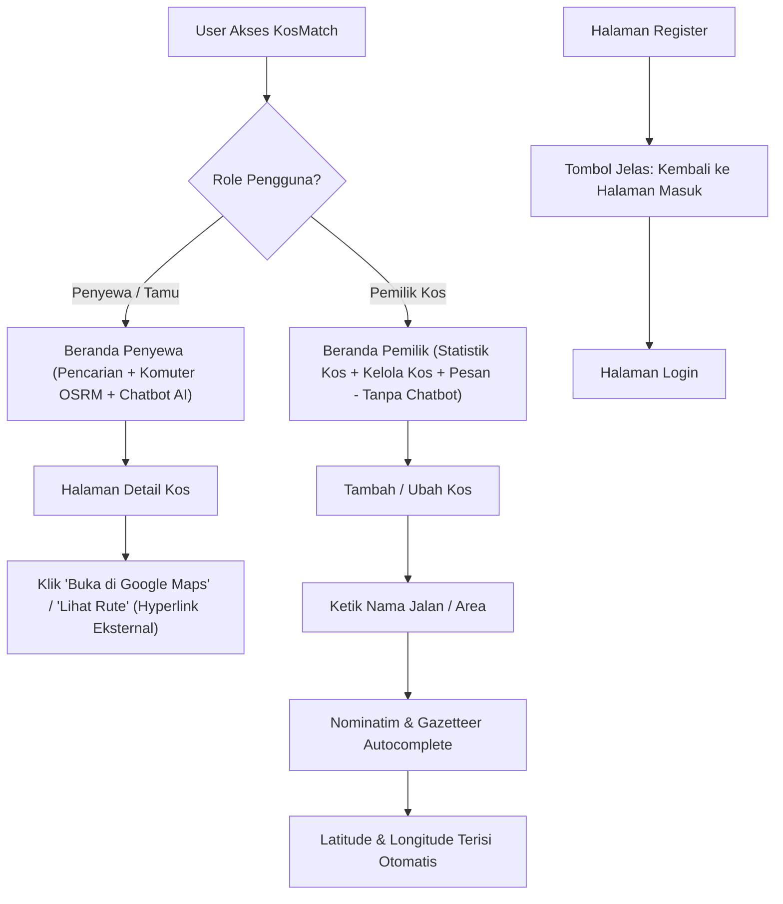

-m # Product Requirement Document (PRD)
## Penyempurnaan Platform KosMatch Jakarta: Owner Experience, Commute Routing, Google Maps Navigation & Testing Revamp

- **Nama Dokumen:** KosMatch Platform Enhancement PRD
- **Target Rilis:** KosMatch Jakarta v1.1
- **Status Dokumen:** Proposed / Menunggu Konfirmasi Tim
- **Role Terkait:** `owner` (Pemilik Kos), `tenant` (Calon Penyewa), & QA / Developer

---

## 1. Latar Belakang & Masalah

1. **Kendala Input Koordinat (Latitude & Longitude):**
   * *Kondisi saat ini:* Pemilik kos diwajibkan memasukkan angka koordinat lintang dan bujur secara manual pada form penambahan/pengubahan kos ([OwnerPages.tsx](file:///d:/Ngoding%20lek%20ku/KosMatch/KosMatch_Group4/apps/web/src/pages/OwnerPages.tsx)).
   * *Dampak:* Pemilik kos awam kesulitan menentukan angka desimal lokasinya, menimbulkan friksi pendaftaran dan risiko input data keliru.

2. **Beranda Belum Membedakan Peran (*Role Differentiation*):**
   * *Kondisi saat ini:* Saat pemilik kos login, beranda utama (`/`) tetap menampilkan tampilan pencarian calon penyewa (filter komuter, pencarian kampus/kantor, rekomendasi kos publik, dan chatbot AI rekomendasi kos).
   * *Dampak:* Fitur chatbot rekomendasi kos dan filter pencarian tidak relevan bagi pemilik kos yang berfokus mengelola propertinya.

3. **Kemudahan Navigasi Halaman Registrasi:**
   * *Kondisi saat ini:* Pada halaman pendaftaran akun ([AuthPages.tsx](file:///d:/Ngoding%20lek%20ku/KosMatch/KosMatch_Group4/apps/web/src/pages/AuthPages.tsx)), navigasi untuk kembali ke halaman Login hanya berupa teks kecil di bagian paling bawah.
   * *Dampak:* Calon pengguna (baik penyewa maupun pemilik) yang keliru menekan tombol daftar merasa navigasinya kurang jelas.

4. **Keterbatasan Estimasi Komuter Garis Lurus (Commute Estimate):**
   * *Kondisi saat ini:* Formula awal komuter hanya mengalikan jarak garis lurus Haversine dengan faktor kelokan $1.3$.
   * *Dampak:* Jarak tempuh dan durasi ojek/transit sering kurang akurat pada koridor Jakarta yang padat, satu arah, atau terhalang jalan tol/rel kereta.

5. **Kebutuhan Navigasi Visual Google Maps Tanpa Biaya API:**
   * *Kondisi saat ini:* Pengguna ingin melihat letak fisik kos dan navigasi rute langsung di aplikasi Google Maps di HP/komputer mereka tanpa platform harus membayar biaya Google Maps JavaScript API SDK.
   * *Dampak:* Dibutuhkan integrasi URL *hyperlink* eksternal yang aman dan dinamis.

6. **Kebutuhan Fitur Penghapusan Pesan Obrolan (*Chat Deletion*):**
   * *Kondisi saat ini:* Pada fitur chat real-time, pengguna belum dapat menghapus pesan yang keliru dikirim (*typo* atau salah kirim) maupun membersihkan riwayat pesan dari lawan bicara di layar sendiri.
   * *Dampak:* Mengurangi kenyamanan, privasi, dan kendali pengguna atas riwayat percakapan.

7. **Kebutuhan Standarisasi & Revisi Testing:**
   * *Kondisi saat ini:* PRD awal baru menetapkan *smoke test* dan tes unit dasar sederhana.
   * *Dampak:* Belum ada standarisasi uji akurasi AI Chatbot (target $\ge 90\%$), uji *safety guardrails*, dan panduan checklist pengujian manual pengguna (UAT).

---

## 2. Tujuan & Sasaran (Objectives & Scope)

1. **Otomatisasi Penentuan Koordinat:** Pemilik kos cukup mencari dan memilih alamat/jalan/area; sistem secara otomatis menetapkan `latitude` dan `longitude` di balik layar menggunakan geocoder open-source (Nominatim & Gazetteer lokal).
2. **Beranda Khusus Pemilik Kos (*Owner Homepage*):**
   * Menampilkan beranda ringkasan properti, aksi cepat tambah kos, dan pesan masuk.
   * **Chatbot AI (widget mengambang dan tombol CTA AI) dihilangkan sepenuhnya** untuk pemilik kos.
3. **Penyempurnaan Navigasi Auth:** Menambahkan tombol "Kembali ke Halaman Masuk" yang jelas pada halaman pendaftaran.
4. **Peningkatan Akurasi Estimasi Komuter (*Real-World Routing*):**
   * Mengintegrasikan mesin routing nyata OSRM (*Open Source Routing Machine*) berbasis jaringan jalan OpenStreetMap.
   * Mengalkulasi kecepatan ojek motor (15% lebih cepat dari mobil di kemacetan Jakarta).
   * Menerapkan *in-memory cache* dan *automatic fallback* ke `MockCommuteProvider`.
5. **Hyperlink Navigasi Google Maps Eksternal:** Menghubungkan titik koordinat kos dan rute destinasi ke URL resmi Google Maps Search & Directions.
6. **Penghapusan Pesan Chat Granular (Real-Time & Local Privacy):**
   * Memberikan kemampuan bagi pengirim pesan untuk menghapus pesan bagi semua orang (*Delete for Everyone*) atau hanya untuk dirinya sendiri (*Delete for Me*).
   * Memberikan perlindungan bagi penerima pesan untuk membersihkan pesan lawan bicara dari layar pribadinya (*Delete for Me*) tanpa mengganggu riwayat lawan bicara.
7. **Revisi Testing Komprehensif:** Menyediakan test suite otomatis berbasis Vitest, QA accuracy benchmark untuk Chatbot AI, dan skenario checklist User Acceptance Testing (UAT).

---

## 3. Spesifikasi Rinci Fitur

---

### 3.1. Fitur 1: Otomatisasi Titik Lokasi & Koordinat Kos (Owner POV)

#### **A. Perubahan Formulir Kos (`OwnerKosFormPage`)**
* **Sembunyikan Kolom Angka Koordinat:**
  * Kolom `latitude` dan `longitude` dihilangkan dari tampilan utama form dan dikelola otomatis di *form state*.
  * Tersedia accordion opsional *"Pengaturan Koordinat Lanjutan"* (tertutup secara default) jika pemilik ingin melihat/mengubah angka koordinat secara manual.
* **Komponen Autocomplete Alamat & Area (`LocationAutocompleteInput`):**
  * Terhubung ke modul [NominatimGeocoder.ts](file:///d:/Ngoding%20lek%20ku/KosMatch/KosMatch_Group4/apps/api/src/providers/commute/NominatimGeocoder.ts) & kamus koridor Jabodetabek di `@kosmatch/shared`.
  * Saat pemilik mengetik minimal 3 karakter (misal: *"Tebet Barat"* atau *"Jl. Margonda"*), sistem menampilkan *dropdown* saran alamat/jalan/area.
  * Begitu dipilih:
    1. Kolom teks `area` terisi otomatis dengan nama lokasi yang rapi.
    2. Nilai `latitude` dan `longitude` terisi otomatis sesuai titik geocoding.
* **Kolom Tambahan: Alamat Lengkap & Patokan Fisik:**
  * Menambahkan field teks `alamatLengkap` / `patokan` (misal: *"No. 12B, masuk gang samping minimarket, pagar hitam"*).
  * Field ini ditampilkan pada halaman detail kos untuk memandu calon penyewa saat survei langsung ke lokasi.

---

### 3.2. Fitur 2: Diferensiasi Beranda Pemilik Kos

#### **A. Beranda Bersyarat Berdasarkan Peran (`LandingPage.tsx` / `OwnerHomeView`)**
Jika `user.role === 'owner'`:
1. **Peniadaan Chatbot AI:**
   * Floating Chatbot widget di pojok kanan bawah **disembunyikan** (`null`).
   * Tombol hero *"Cari Kos dengan AI Chatbot"* **dihilangkan**.
   * Shortcut keyboard pembuka chatbot dinonaktifkan.
2. **Peniadaan Filter Pencarian Penyewa:**
   * Kolom input *"Lokasi Tujuan"*, *"Waktu Tempuh Maks"*, dan *"Biaya Sewa"* tidak ditampilkan.
3. **Komponen Tampilan Beranda Pemilik:**
   * **Hero Header Pemilik:** Sapaan personal (*"Selamat Datang, [Nama Pemilik]"*) + lencana akun *Pemilik Kos Terverifikasi*.
   * **Aksi Cepat (*Quick Actions*):** Tombol **"+ Tambah Kos Baru"**, **"Kelola Kos Saya"**, dan **"Buka Pesan Masuk"**.
   * **Ringkasan Kos Saya (*Owner's Properties Grid*):** Menampilkan daftar kos milik sendiri dengan aksi langsung: **"Ubah Kos"**, **"Lihat Tampilan Publik"**, dan **"Hapus"**.
   * **Sekilas Pesan Calon Penyewa:** Menampilkan ringkasan pesan masuk terbaru dari penyewa beserta tombol balas langsung ke `/chat`.

#### **B. Penyesuaian Navigasi (Navbar)**
* Menu navbar pemilik disederhanakan: **Beranda** (`/`), **Kos Saya** (`/owner/kos`), dan **Pesan** (`/chat`). Menu pencarian dan bookmark disembunyikan.

---

### 3.3. Fitur 3: Tombol Kembali ke Halaman Masuk pada Halaman Registrasi

#### **A. Perubahan pada `RegisterPage` ([AuthPages.tsx](file:///d:/Ngoding%20lek%20ku/KosMatch/KosMatch_Group4/apps/web/src/pages/AuthPages.tsx))**
* **Tombol Navigasi Atas:**
  * Di bagian atas kartu pendaftaran, tambahkan tombol navigasi: `← Kembali ke Halaman Masuk`.
* **Tombol Aksi Sekunder di Bawah Form:**
  * Di samping atau di bawah tombol utama *"Daftar"*, tambahkan tombol berpenampilan *outline/secondary*:
    **"Sudah Punya Akun? Masuk di Sini"**.
  * Tetap mempertahankan parameter query `redirect` agar alur login tidak terputus.

---

### 3.4. Fitur 4: Penyempurnaan Estimasi Komuter (*Commute Estimate Revamp*)

Meningkatkan kalkulasi dari estimasi garis lurus kasar menjadi perhitungan jaringan jalan riil Jakarta:

1. **Integrasi OSRM (`OsrmCommuteProvider.ts`):**
   * Menggunakan endpoint routing OpenStreetMap:
     `GET {OSRM_BASE_URL}/route/v1/driving/{kosLng},{kosLat};{destLng},{destLat}?overview=false`
   * Jarak tempuh riil dihitung dari `route.distance / 1000` (dibulatkan 1 desimal).
2. **Formula Durasi Ojek Motor di Jakarta:**
   * Sepeda motor di jalanan Jakarta dapat bermanuver menghindari kemacetan, sehingga diestimasi **15% lebih cepat** dibandingkan durasi berkendara mobil:
     $$\text{durationMin} = \max\left(3, \left\lceil \text{drivingDurationMin} \times 0.85 \right\rceil\right)$$
3. **Formula Biaya Ojek & Transit Publik:**
   * **Ojek:** $\max\left(8.000, \text{roundTo500}(3.000 \times \text{distanceKm})\right)$
   * **Transit:** $\min\left(10.000, \text{roundTo500}(3.000 + 300 \times \text{distanceKm})\right)$ dengan durasi $\lceil (\text{km}/28 \times 60) + 10 \rceil$ menit.
4. **Ketahanan Jaringan (*Resiliency & Caching*):**
   * *In-memory cache* (`Map<string, CachedRoute>`) untuk rute yang sering diakses.
   * Batas konkurensi (maksimal 6 *active requests*) dan timeout (2.000 ms).
   * *Automatic fallback* ke `MockCommuteProvider` (Haversine $\times 1.3$) jika layanan OSRM tidak terjangkau.
   * Metadata respon wajib menyertakan `isEstimate: true` dan `source: "mock"` untuk transparansi.

---

### 3.5. Fitur 5: Hyperlink Navigasi Eksternal ke Google Maps

Menyediakan tautan langsung ke layanan Google Maps resmi tanpa memerlukan API Key berbayar:

1. **Hyperlink Lokasi Kos Fisik:**
   * Pada [KosDetailPage.tsx](file:///d:/Ngoding%20lek%20ku/KosMatch/KosMatch_Group4/apps/web/src/pages/KosDetailPage.tsx), disediakan tombol **"Buka di Google Maps"** / **"Lihat Lokasi Maps"**:
     $$\text{URL} = \text{https://www.google.com/maps/search/?api=1\&query=}\{\text{kos.latitude}\},\{\text{kos.longitude}\}$$
2. **Hyperlink Navigasi Rute Komuter (*Turn-by-Turn Directions*):**
   * Jika pengguna memilih destinasi komuter (kampus/kantor), tampilkan tombol **"Lihat Rute ke [Nama Destinasi] di Google Maps"**:
     $$\text{URL} = \text{https://www.google.com/maps/dir/?api=1\&origin=}\{\text{kos.lat}\},\{\text{kos.lng}\}\&destination=\{\text{dest.lat}\},\{\text{dest.lng}\}$$
3. **Standar Keamanan Tautan:**
   * Menggunakan atribut `target="_blank"` dan `rel="noopener noreferrer"` untuk keamanan dan kenyamanan browsing pengguna.

---

### 3.6. Fitur 6: Standarisasi & Revisi Testing (QA & Testing Revamp)

Memperbarui strategi pengujian dari verifikasi manual sederhana menjadi standar pengujian bertingkat:

#### **A. Pengujian Otomatis Developer (Vitest Suites)**
* **Unit Testing Provider:**
  * Pengujian komuter [MockCommuteProvider.test.ts](file:///d:/Ngoding%20lek%20ku/KosMatch/KosMatch_Group4/apps/api/src/providers/commute/MockCommuteProvider.test.ts): validasi rumus Haversine, tarif minimum ojek, cap biaya transit, dan batas jalan kaki $\le 1.5$ km.
* **Pengujian Akurasi AI Chatbot (`chatbotAccuracy.test.ts`):**
  * Evaluasi terhadap $\ge 100$ ragam *benchmark query* percakapan bahasa alami (ekstraksi budget sewa, ekstraksi budget komuter, alias destinasi, mode transportasi).
  * Standar ambang batas kelulusan: **Akurasi $\ge 90\%$** pada ekstraksi parameter pencarian.
* **Pengujian Guardrails Keamanan Agen (`agentGuardrails.test.ts`):**
  * Uji Layer 1 (Keyword relevance matching).
  * Uji Layer 2 (Prompt injection & jailbreak defense).
  * Uji Layer 3 (Enforce label estimasi pada komuter).
  * Uji Layer 4 (Validasi skema respon Zod).

#### **B. Pengujian Penerimaan Pengguna (*User Acceptance Testing / UAT*)**
* Mengacu pada dokumen panduan [USER_TESTING_CHECKLIST.md](file:///d:/Ngoding%20lek%20ku/KosMatch/KosMatch_Group4/docs/USER_TESTING_CHECKLIST.md):
  * **Skenario 1 (Penyewa):** Registrasi, pencarian multi-parameter, interaksi chatbot AI, simpan bookmark, dan pembukaan hyperlink Google Maps.
  * **Skenario 2 (Pemilik):** Registrasi pemilik, penambahan kos dengan lokasi otomatis, pengubahan kos, penghapusan kos, dan penerimaan chat real-time via Socket.IO.
  * **Skenario 3 (Real-Time Communication):** Dua browser bertukar pesan secara instan tanpa reload.

---

### 3.7. Fitur 7: Penghapusan Pesan Chat (*Chat Message Deletion*)

Menyediakan fungsionalitas bagi pengguna untuk menghapus pesan percakapan, baik yang dikirim oleh diri sendiri maupun pesan dari lawan bicara:

#### **A. Pesan yang Dikirim oleh Pengguna Sendiri (*Sender POV*)**
1. **Opsi Penghapusan Ganda:**
   * **Hapus untuk Semua Orang (*Delete for Everyone*):**
     * Menghapus pesan secara permanen dari basis data backend melalui endpoint REST `DELETE /chats/messages/:id`.
     * Memancarkan event WebSocket Socket.IO `message:deleted` ke ruangan pengirim (`user:${senderId}`) dan penerima (`user:${receiverId}`) secara instan.
     * Pesan langsung hilang dari layar pengirim dan lawan bicara tanpa perlu me-refresh halaman.
   * **Hapus untuk Saya Saja (*Delete for Me*):**
     * Pesan hanya disembunyikan dari layar pengirim lokal.
     * ID pesan yang dihapus disimpan di penyimpanan lokal per pengguna (`localStorage.getItem('kosmatch_deleted_for_me_' + userId)`).
     * Pesan tetap tersimpan di server dan tetap terlihat utuh di perangkat lawan bicara.

#### **B. Pesan yang Diterima dari Lawan Bicara (*Receiver POV*)**
1. **Opsi Penghapusan Tunggal (Hanya untuk Saya):**
   * Demi menjaga integritas data dan hak cipta percakapan lawan bicara, penerima **hanya memiliki akses** untuk memilih **"Hapus untuk Saya"**.
   * Pesan disembunyikan dari tampilan obrolan penerima saat itu juga dan ID-nya dicatat ke dalam daftar `deletedForMeIds`.
   * Server database dan lawan bicara (pengirim asli) tetap mempertahankan isi pesan tersebut secara normal.

#### **C. Antarmuka & Interaksi Pengguna (*UI/UX*)**
* Tombol pemicu berupa ikon tempat sampah (*trash can*) yang muncul halus saat pengguna mengarahkan kursor (*hover*) pada bubble pesan chat.
* Dialog konfirmasi aman (*Modal Confirmation*) dengan pratinjau cuplikan pesan yang akan dihapus untuk mencegah ketidaksengajaan klik.
* Penanganan status *loading* saat proses penghapusan jaringan berlangsung untuk menjamin responsivitas antarmuka.

---

## 4. Matriks Kriteria Penerimaan (Acceptance Criteria)

| ID | Fitur | Kriteria Keberhasilan |
| :--- | :--- | :--- |
| **AC-01** | Input Lokasi Otomatis | Mengetik nama jalan/area memunculkan saran dropdown; memilih salah satu saran otomatis mengisi `latitude` & `longitude`. |
| **AC-02** | Beranda Khusus Pemilik | Akun `owner` mengakses `/` disajikan beranda ringkasan properti milik sendiri, tombol aksi cepat, dan **tanpa widget/tombol Chatbot AI**. |
| **AC-03** | Tombol Kembali di Register | Halaman registrasi memiliki tombol navigasi kembali ke login yang jelas di bagian atas dan bawah form. |
| **AC-04** | Akurasi Komuter OSRM | Estimasi waktu & ongkos menggunakan jarak rute jalan riil OSRM; durasi ojek memperhitungkan faktor $0.85$ kecepatan motor; fallback aktif jika OSRM timeout. |
| **AC-05** | Hyperlink Google Maps | Tombol "Lihat Lokasi Maps" dan "Lihat Rute di Google Maps" membuka halaman Google Maps resmi di tab baru dengan koordinat yang presisi. |
| **AC-06** | Keandalan Testing | Seluruh unit test Vitest lulus (`pnpm test`), pengujian akurasi chatbot mencapai $\ge 90\%$, dan checklist UAT lolos pengujian manual. |
| **AC-07** | Hapus Pesan Chat | Pengirim dapat memilih "Hapus untuk Semua Orang" (sinkron via socket) atau "Hapus untuk Saya Saja"; penerima hanya dapat memilih "Hapus untuk Saya"; pesan yang dihapus lokal tersimpan di storage per user. |

---

## 5. Rencana Tahapan Implementasi

1. **Fase 1: Auth & Navigasi (Quick Wins)**
   * Tambahkan tombol kembali ke halaman login pada `RegisterPage` di [AuthPages.tsx](file:///d:/Ngoding%20lek%20ku/KosMatch/KosMatch_Group4/apps/web/src/pages/AuthPages.tsx).
2. **Fase 2: Otomatisasi Input Lokasi Kos (Owner Form)**
   * Pasang komponen `LocationAutocomplete` pada [OwnerPages.tsx](file:///d:/Ngoding%20lek%20ku/KosMatch/KosMatch_Group4/apps/web/src/pages/OwnerPages.tsx) berbasis `NominatimGeocoder` dan sembunyikan input angka koordinat manual.
3. **Fase 3: Beranda Khusus Pemilik Kos**
   * Implementasikan kondisional tampilan di [LandingPage.tsx](file:///d:/Ngoding%20lek%20ku/KosMatch/KosMatch_Group4/apps/web/src/pages/LandingPage.tsx) untuk me-render `OwnerHomeView` dan menonaktifkan Chatbot AI untuk role owner.
4. **Fase 4: Finalisasi Routing Komuter & Hyperlink Google Maps**
   * Pastikan konfigurasi provider OSRM dan tautan `googleMapsUrl` / `googleMapsDirUrl` di [KosDetailPage.tsx](file:///d:/Ngoding%20lek%20ku/KosMatch/KosMatch_Group4/apps/web/src/pages/KosDetailPage.tsx) terhubung sempurna.
5. **Fase 5: Fitur Penghapusan Pesan Chat (Full Stack)**
   * Bangun endpoint `DELETE /chats/messages/:id` dan event Socket.IO `message:deleted` di backend.
   * Pasang modal konfirmasi dan persistensi `deletedForMeIds` pada komponen chat di frontend.
6. **Fase 6: Validasi Pengujian & Dokumentasi QA**
   * Jalankan seluruh suite `pnpm test` (Vitest, guardrails, accuracy test) dan verifikasi checklist UAT.
